<p align="center">
  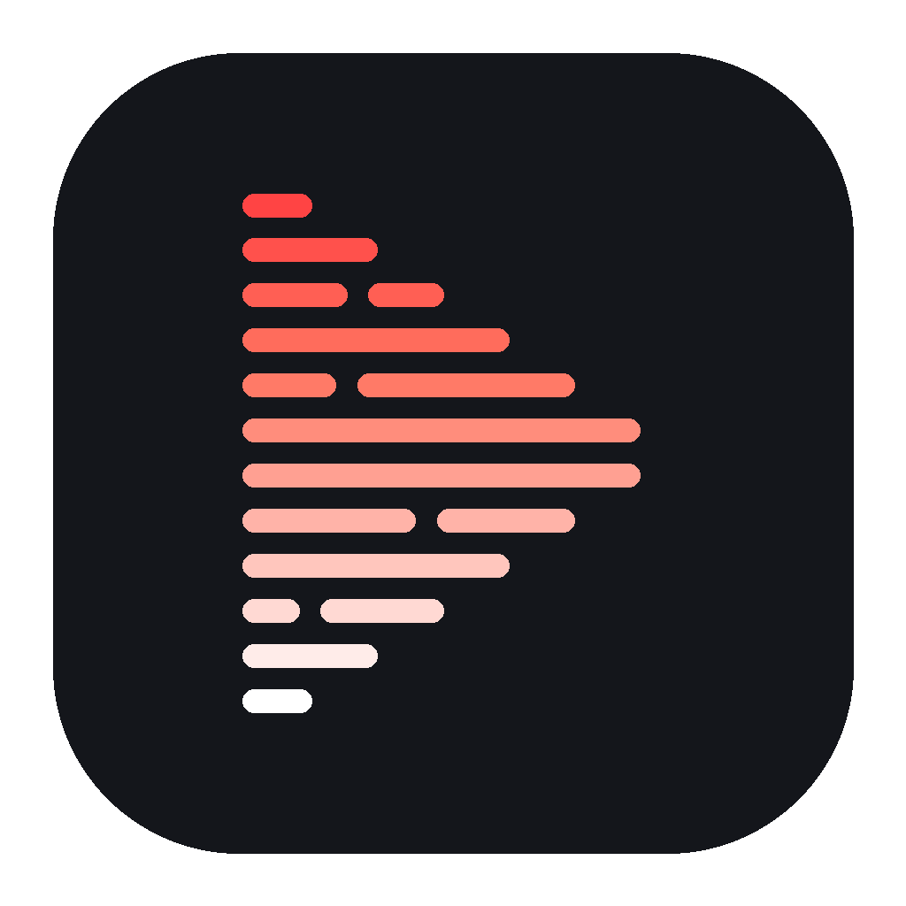
</p>

<h1 align="center">TubExtractor</h1>

<p align="center">
  <b>Batch YouTube transcripts on Android.</b><br>
  Videos, playlists and whole channels. No account, no server, no cost.
</p>

<p align="center">
  <a href="https://github.com/fabriciocotrim/TubExtractor/actions/workflows/tests.yml"></a>
  <a href="https://github.com/fabriciocotrim/TubExtractor/releases/latest"></a>
  <a href="LICENSE"></a>
</p>

<p align="center">English · <a href="README.pt-BR.md">Português</a></p>

<p align="center">
  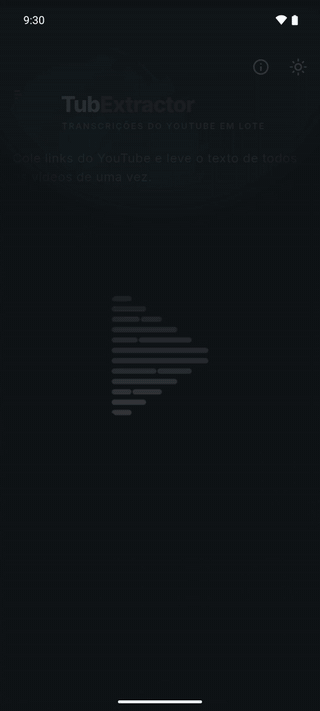
</p>

## What it does

Paste a YouTube link, or tap **Share** in the YouTube app. TubExtractor fetches the transcript of every video and lets you read, search, copy and export them.

- **Any link:** video, playlist, channel, @handle or Shorts. Several links at once, one per line.
- **Batch:** up to 500 videos per search, newest first for channels, playlist order for playlists.
- **Formats:** TXT, SRT, VTT, Markdown or JSON, with or without timestamps.
- **100+ languages:** if a video has no track in your language, the app uses YouTube's automatic translation, then the original track.
- **Clear status:** every video shows ready, queued or failed, with the reason.
- **Reader:** search inside a transcript, jump to the moment on YouTube, copy everything.
- **ZIP export:** one file per video plus `manifest.csv` and `manifest.json`.
- **Resumes:** an interrupted search continues when you open the app again. Deleted searches can be undone for 5 seconds.
- **Private:** no account, no analytics. The app talks only to YouTube. See the [privacy policy](artefatos/docs/PRIVACY_POLICY.md).

The interface is in Brazilian Portuguese. Transcripts come in any language YouTube offers.

## Screens

| Home | Search | Reader | Export |
|:---:|:---:|:---:|:---:|
| 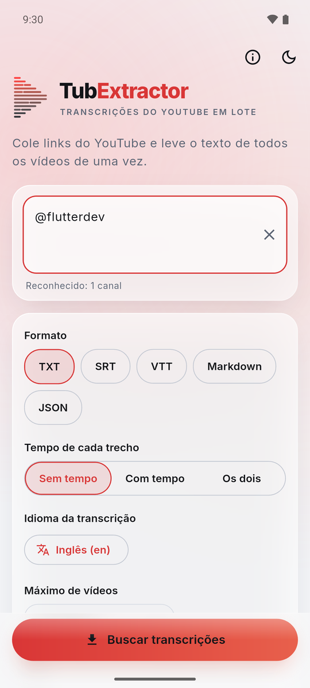 | 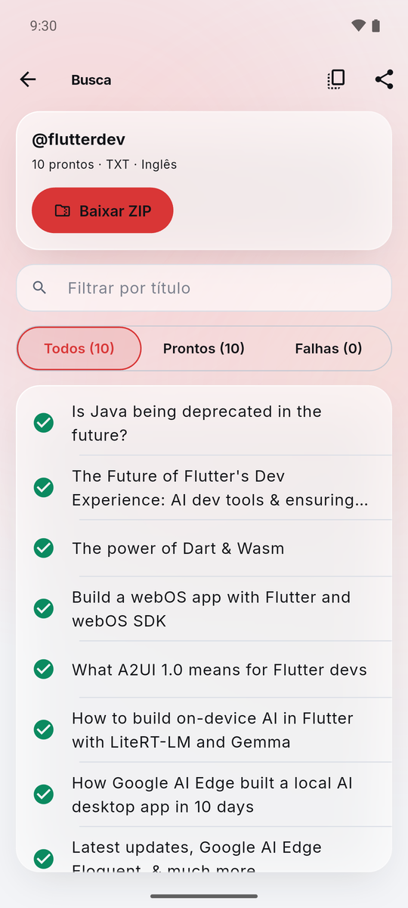 | 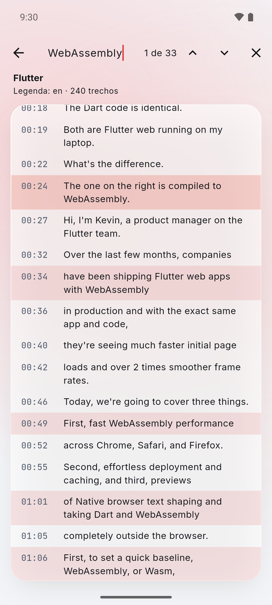 | 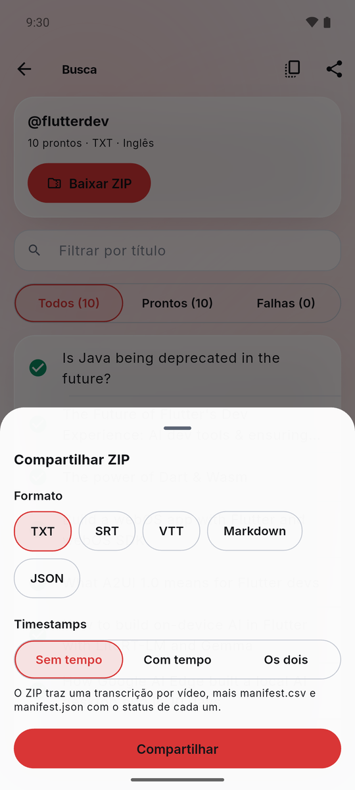 |
| 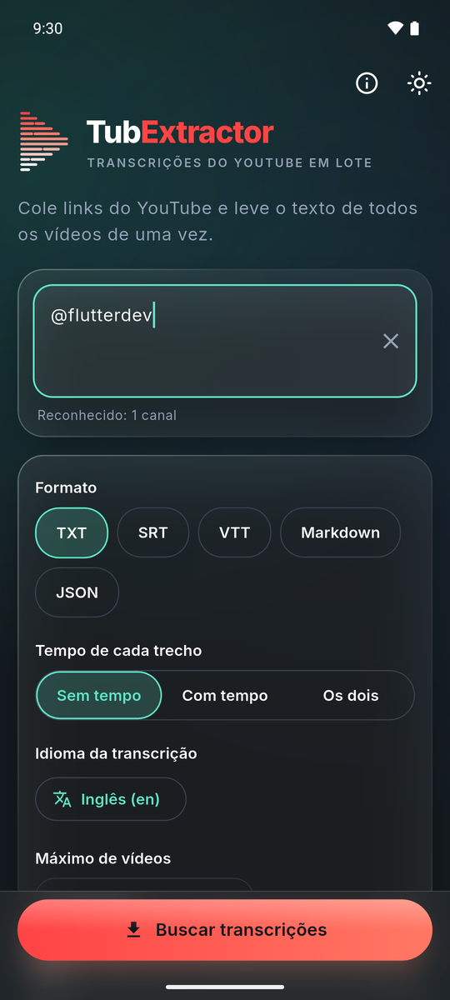 | 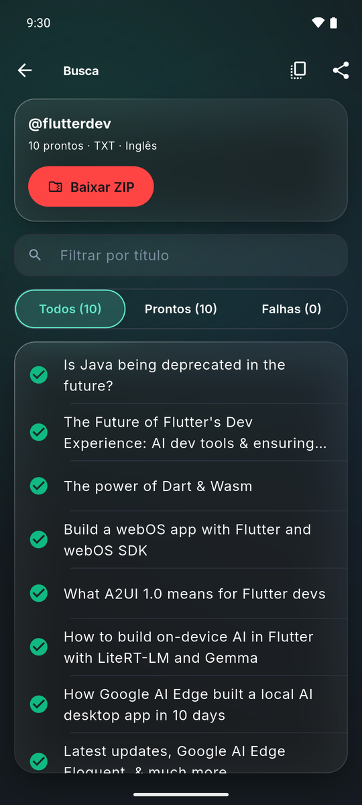 | 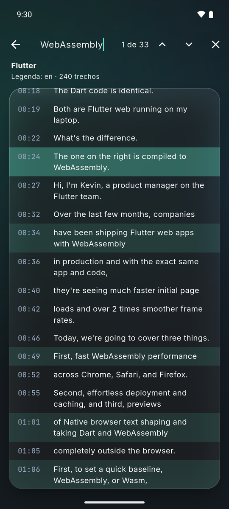 | 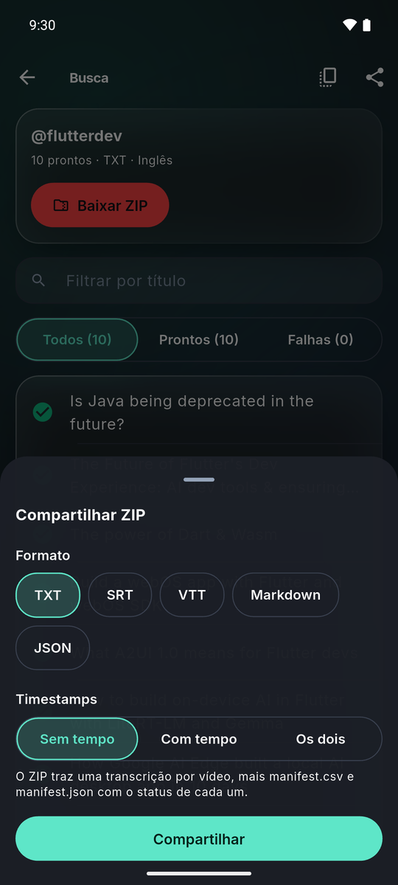 |

## Install

1. Download the `.apk` from the [latest release](https://github.com/fabriciocotrim/TubExtractor/releases/latest) (Android 7.0+, arm64).
2. Open it on your phone and allow installs from this source.
3. New versions install over the old one and keep your history.

TubExtractor is not on Google Play.

## How it's built

### Architecture

Everything runs on the phone. There is no backend.

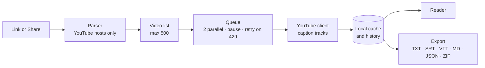

Flutter 3.47 / Dart, Android only. All knowledge about YouTube lives in one module, so a YouTube change is fixed in one place. A live check script tells when YouTube changed something.

### Quality

- **168 automated tests** (unit and widget), run on every push by GitHub Actions. Static analysis with zero warnings.
- Tests cover the real paths that broke in development, for example the undo of a deleted search, with random sequences of actions.
- Every release is also tested by hand on an emulator and on a real phone.

### Security

- Threat model per asset in [SECURITY.md](SECURITY.md): malicious shared text, path traversal in ZIP names, formula injection in the CSV, caption URLs pointing outside YouTube, rate limiting.
- Security gate before every release: secret scan of the code and of the whole Git history (gitleaks), static analysis with 79 OWASP Top 10 and secret rules (semgrep), dependency vulnerabilities (osv-scanner).
- The signing key never enters the repository. A release build fails without it.

### Process

TubExtractor was built with [Claude Code](https://claude.com/claude-code) (Anthropic) in a written 7-phase workflow. Fabrício defines the product, makes every product and risk decision, and tests on the phone. Claude Code writes the code and the tests.

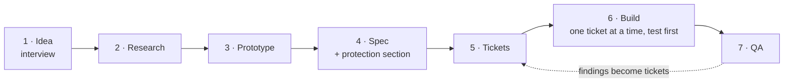

Phase 7 runs in a fixed order: tests and CI → code review → security gate → review by a second model (Gemini) → an independent judge agent that can only approve or reject → manual tests on the device. Research and prototype are optional.

## Development

```bash
flutter test                 # all tests
flutter analyze              # static analysis
flutter build apk --release  # signed APK (needs android/key.properties)
dart run tool/live_check.dart  # checks the YouTube integration against the live site
```

The signing key stays outside the repository. Without it, a new version does not install over the old one. The Android package id is `com.fabriciocotrim.subshaul`, kept from the project's first name so updates install in place.

Bug reports are welcome through [Issues](https://github.com/fabriciocotrim/TubExtractor/issues/new/choose). This is a personal project: there is no response deadline.

## License and notice

Code under the [Apache-2.0](LICENSE) license. The TubExtractor name and logo are not licensed; see [NOTICE](NOTICE).

TubExtractor is not affiliated with, endorsed by or sponsored by YouTube or Google. It reads public captions through YouTube's internal endpoints, not the official Data API, and may stop working when YouTube changes them. Use it in line with YouTube's Terms of Service; you are responsible for how you use it.

## Contact

Fabrício Cotrim · [LinkedIn](https://www.linkedin.com/in/fabr%C3%ADcio-cotrim-b565a073/)
