<p align="center">
  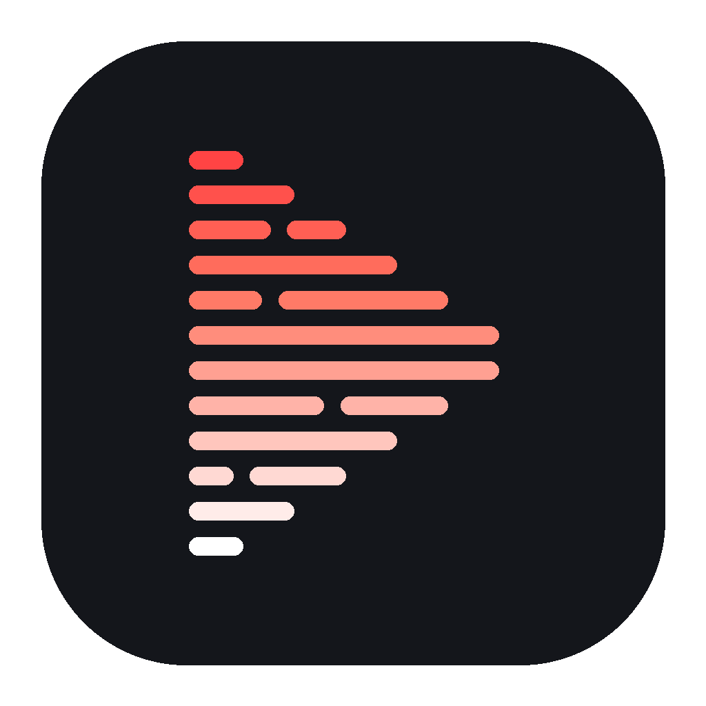
</p>

<h1 align="center">TubExtractor</h1>

<p align="center">
  <b>Transcrições do YouTube em lote, no Android.</b><br>
  Vídeos, playlists e canais inteiros. Sem conta, sem servidor, sem custo.
</p>

<p align="center">
  <a href="https://github.com/fabriciocotrim/TubExtractor/actions/workflows/tests.yml"></a>
  <a href="https://github.com/fabriciocotrim/TubExtractor/releases/latest"></a>
  <a href="LICENSE"></a>
</p>

<p align="center"><a href="README.md">English</a> · Português</p>

<p align="center">
  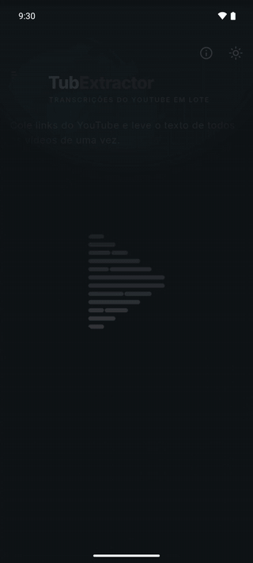
</p>

## O que faz

Cole um link do YouTube ou toque em **Compartilhar** no app do YouTube. O TubExtractor baixa a transcrição de cada vídeo. Você lê, busca, copia e exporta.

- **Qualquer link:** vídeo, playlist, canal, @handle ou Shorts. Vários links de uma vez, um por linha.
- **Em lote:** até 500 vídeos por busca. Canal vem do mais novo ao mais antigo; playlist, na ordem dela.
- **Formatos:** TXT, SRT, VTT, Markdown ou JSON, com ou sem marcação de tempo.
- **Mais de 100 idiomas:** se o vídeo não tem legenda no seu idioma, o app usa a tradução automática do YouTube e, depois, a legenda original.
- **Status claro:** cada vídeo mostra pronto, na fila ou falha, com o motivo.
- **Leitor:** busca dentro da transcrição, abre o vídeo no ponto certo do YouTube, copia tudo.
- **ZIP:** um arquivo por vídeo, mais `manifest.csv` e `manifest.json`.
- **Retoma:** uma busca interrompida continua quando o app abre de novo. Busca apagada pode ser desfeita por 5 segundos.
- **Privado:** sem conta, sem analytics. O app fala só com o YouTube. Veja a [política de privacidade](artefatos/docs/PRIVACY_POLICY.pt-BR.md).

## Telas

| Início | Busca | Leitor | Exportar |
|:---:|:---:|:---:|:---:|
| 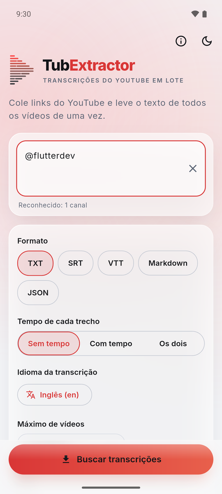 | 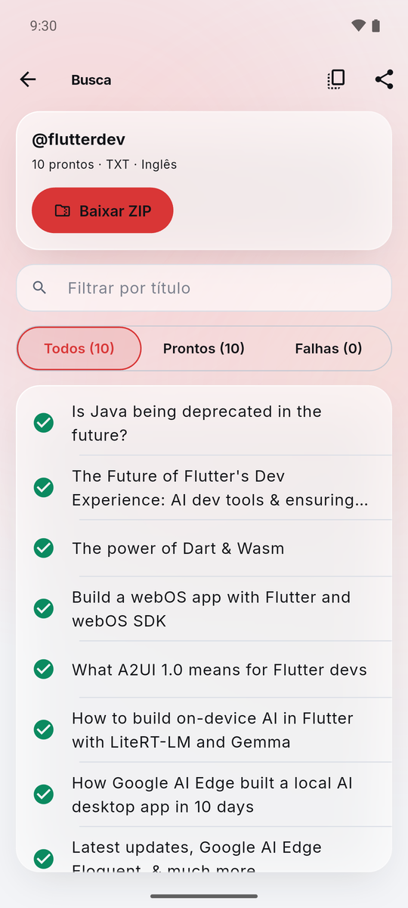 | 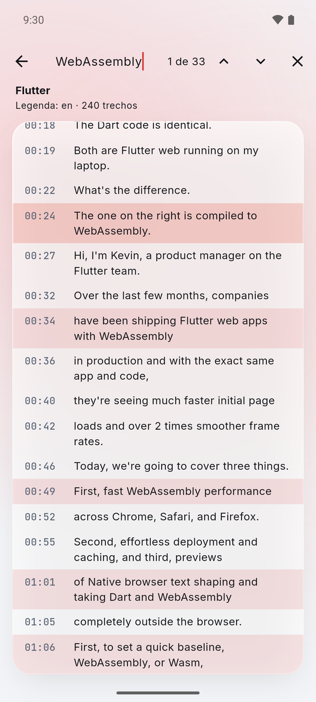 | 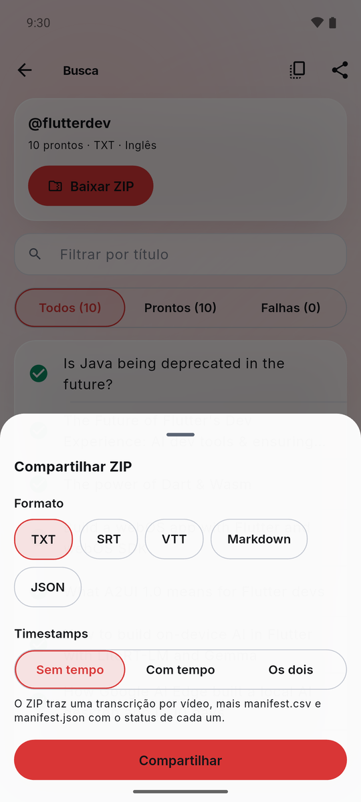 |
| 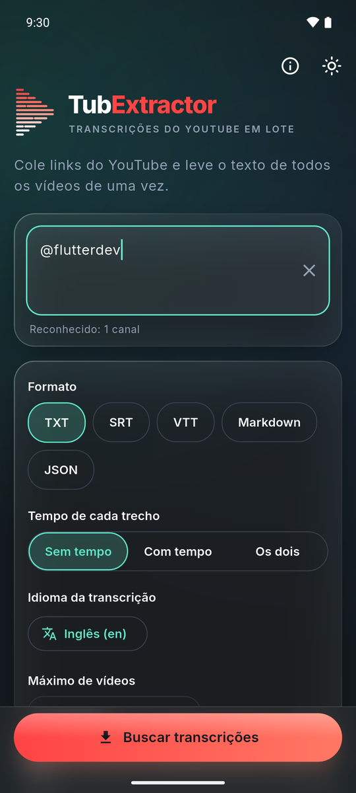 | 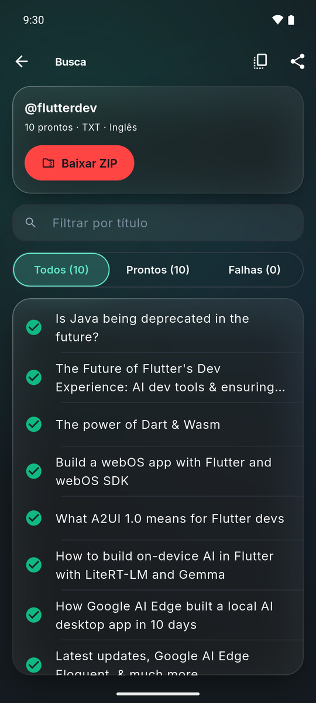 | 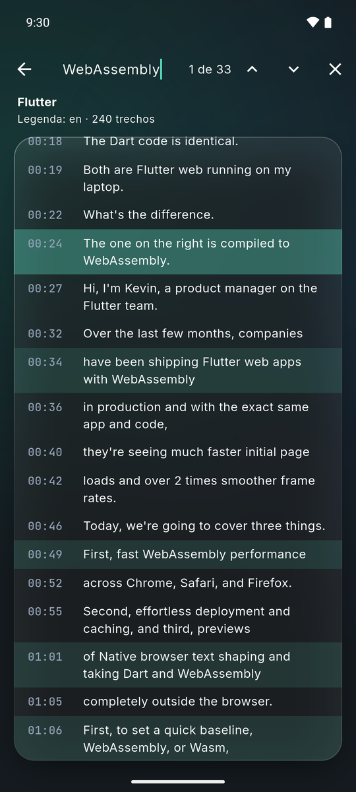 | 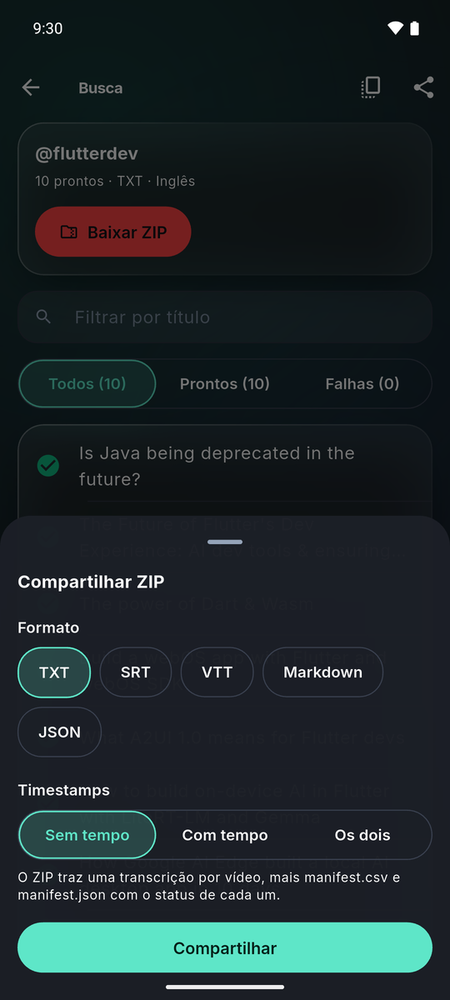 |

## Instalar

1. Baixe o `.apk` na [última versão](https://github.com/fabriciocotrim/TubExtractor/releases/latest) (Android 7.0 ou mais novo, arm64).
2. Abra no celular e permita a instalação desta fonte.
3. Uma versão nova instala por cima da antiga e mantém o histórico.

O TubExtractor não está na Google Play.

## Como foi feito

### Arquitetura

Tudo roda no celular. Não há servidor.

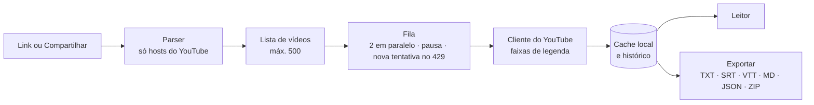

Flutter 3.47 / Dart, só Android. Todo o conhecimento sobre o YouTube fica num único módulo: uma mudança do YouTube se corrige num lugar só. Um script de verificação ao vivo avisa quando o YouTube mudou algo.

### Qualidade

- **168 testes automáticos** (unidade e widget), rodados a cada envio pelo GitHub Actions. Análise estática sem nenhum aviso.
- Os testes cobrem os caminhos reais que quebraram no desenvolvimento, por exemplo o desfazer de uma busca apagada, com sequências aleatórias de ações.
- Cada versão também é testada à mão no emulador e num celular real.

### Segurança

- Modelo de ameaças por bem no [SECURITY.md](SECURITY.md): texto compartilhado malicioso, caminho falso no nome dos arquivos do ZIP, fórmula injetada no CSV, legenda apontando para fora do YouTube, limite de pedidos.
- Portão de segurança antes de cada versão: busca de segredos no código e em todo o histórico do Git (gitleaks), análise estática com 79 regras OWASP Top 10 e de segredos (semgrep), vulnerabilidades em dependências (osv-scanner).
- A chave de assinatura nunca entra no repositório. O build de release falha sem ela.

### Processo

O TubExtractor foi feito com o [Claude Code](https://claude.com/claude-code) (Anthropic), num workflow escrito em 7 fases. O Fabrício define o produto, toma toda decisão de produto e de risco e testa no celular. O Claude Code escreve o código e os testes.

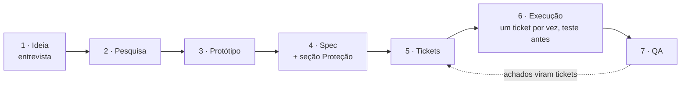

A fase 7 segue uma ordem fixa: testes e CI → revisão de código → portão de segurança → revisão por um segundo modelo (Gemini) → um agente juiz independente, que só aprova ou reprova → testes manuais no aparelho. Pesquisa e protótipo são opcionais.

## Desenvolvimento

```bash
flutter test                 # todos os testes
flutter analyze              # análise estática
flutter build apk --release  # APK assinado (precisa de android/key.properties)
dart run tool/live_check.dart  # confere a integração com o YouTube no site real
```

A chave de assinatura fica fora do repositório. Sem ela, uma versão nova não instala por cima da antiga. O pacote Android é `com.fabriciocotrim.subshaul`, mantido do primeiro nome do projeto para as atualizações instalarem por cima.

Relatos de erro são bem-vindos pelas [Issues](https://github.com/fabriciocotrim/TubExtractor/issues/new/choose). É um projeto pessoal: não há prazo de resposta.

## Licença e aviso

Código sob a licença [Apache-2.0](LICENSE). O nome e o logo TubExtractor não são licenciados; veja o [NOTICE](NOTICE).

O TubExtractor não é afiliado ao YouTube nem ao Google, nem endossado ou patrocinado por eles. Ele lê legendas públicas pelos endpoints internos do YouTube, não pela Data API oficial, e pode parar de funcionar quando o YouTube os mudar. Use de acordo com os Termos de Serviço do YouTube; você responde pelo seu uso.

## Contato

Fabrício Cotrim · [LinkedIn](https://www.linkedin.com/in/fabr%C3%ADcio-cotrim-b565a073/)
